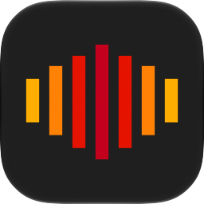
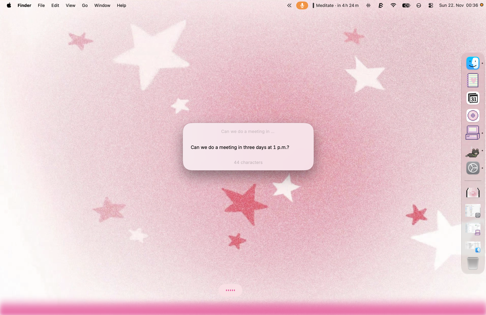

<p align="center">
  <picture>
    <source media="(prefers-color-scheme: dark)" srcset="docs/branding/logo-mark-dark-256.png" width="96" alt="Whistral app icon: a flat seven-bar waveform in amber, orange, and red on a dark background, in the system squircle.">
    
  </picture>
</p>

# Whistral

An open-source, fully local alternative to Wispr Flow for macOS. Hold a
shortcut, speak, release — your words are typed into whatever app you're
using. Powered by default by [Voz](https://huggingface.co/desert-ant-labs/voz)
(Desert Ant Labs, 25 languages) running **on-device** on the Apple Neural
Engine via Core ML — Mistral's [Voxtral Mini 4B Realtime](https://huggingface.co/mistralai/Voxtral-Mini-4B-Realtime-2602)
on [MLX](https://github.com/ml-explore/mlx) remains available as an
alternative in Settings.
No audio, text, or telemetry ever leaves your Mac.


<a href="https://macpip.com/apps/whistral?ref=badge">
  
</a>
---

## Installation

Choose whichever installation method fits your workflow best:

### Option 1: Via Homebrew Cask (Recommended)

Install and receive automatic updates through Homebrew:

```sh
brew tap ThriveEngineer/whistral https://github.com/ThriveEngineer/Whistral
brew install --cask whistral
```

To update in the future:
```sh
brew upgrade --cask whistral
```

### Option 2: Direct Download (Apple Notarized)

Download the pre-built, notarized release archive directly:

1. Download **[Whistral-0.5.0.zip](https://github.com/ThriveEngineer/Whistral/releases/latest/download/Whistral-0.5.0.zip)** from [GitHub Releases](https://github.com/ThriveEngineer/Whistral/releases/latest).
2. Unpack the zip archive and drag `Whistral.app` into your `/Applications` folder.
3. Launch Whistral. *(Because the app is officially signed with an Apple Developer ID and notarized by Apple's Notary Service, Gatekeeper allows it to launch immediately with zero security blocks).*

### Option 3: Build from Source

Build the latest development version locally using Xcode:

```sh
git clone https://github.com/ThriveEngineer/Whistral.git
cd Whistral
xcodebuild -project Whistral.xcodeproj -scheme Whistral \
  -configuration Release -destination "platform=macOS,arch=arm64" build
```

The resulting `Whistral.app` bundle will be located under `build/DerivedData/Build/Products/Release/`.

---

## Features

- **Native `Fn` dictation shortcut** — tap or hold the `Fn` (Function / Globe 🌐) key to dictate system-wide in any application. Re-recordable to any key combination in Settings.
- **Fluid bottom-edge activation glow** — when voice detection activates, a luminous water-like ripple in your macOS System Settings accent color gently waves along the bottom edge of your screen for 3 seconds before dissolving. Completely click-transparent (`ignoresMouseEvents`), so it never blocks your Dock or apps.
- **Compact bottom-center status pill** — a minimal, non-intrusive floating indicator at the bottom center of your display:
  - 🎙️ **Listening:** animated real-time 5-bar audio waveform.
  - ⏳ **Transcribing:** smooth CoreAnimation loading spinner (dead-centered).
  - 🧹 **Cleaning:** dedicated broom clean-up indicator during Apple Intelligence self-correction.
- **Multilingual Smart Correction & Cross-Sentence Resolution** — uses Apple's on-device Foundation Model to eliminate fillers (*uh*, *um*, *like* / *äh*, *ähm* / *eh*, *este* / *يعني*), accurately resolve cross-sentence self-corrections (e.g. *"meet at 10, sorry I meant 11am"* → *"meet at 11am"*, *"Können wir uns morgen treffen? Nein warte, übermorgen"* → *"Können wir uns übermorgen treffen?"*), while preserving real intent (apologies, additions, and intentional phrasing).
- **Speed vs. Quality presets** — choose between Speed (Fast) and Quality (Accurate) for both speech recognition lookahead and LLM post-processing.
- **In-app update checking** — automatically detects new releases via GitHub Releases in the background, surfacing a one-click download button in the menu bar and Settings.
- **Completely local & private** — speech recognition (Voz on the Neural Engine, or Voxtral on MLX) and smart correction (Apple Foundation Model) run 100% on your Mac; audio is never uploaded.
- **25 languages with the default Voz model** (Voxtral covers 13) — the smart corrector seamlessly processes English, German, Spanish, French, Italian, Portuguese, Arabic, Dutch, Korean, Japanese, Russian, Chinese, and Turkish.
- **Smart insert** — transcribed text lands in the focused text field via a paste that briefly borrows, then restores, your clipboard; a synthetic keystroke mode is available for apps that dislike synthetic pastes.
- **Apple Notarized** — signed with Developer ID and officially notarized & stapled by Apple for seamless, warning-free Gatekeeper validation.

## Requirements

- Apple Silicon Mac (M1 or later), macOS 27.2 or newer
- ~337 MB free disk space for the default Voz model (downloaded once, on first
  use); the Voxtral models need ~3.9–8.6 GB

## Performance

Measured on one Apple M5 machine with 16 GB of unified memory, running the
default 6-bit model; numbers come from a local benchmark, so treat them as a
single data point rather than a promise. The first partial text appears about
0.7 s after speech starts (the first session of a run takes up to about 0.9 s
to warm up), and dictation finalizes about 0.6 s after you stop speaking. The
model loads in about 1 s once cached — a first-ever launch downloads the
~3.9 GB model first. To rerun the benchmark yourself, see
[Tests/perf-report.md](Tests/perf-report.md) and `python3 Tests/bench_latency.py`.

## How it works

- The Swift app captures microphone audio with `AVAudioEngine` and converts
  it to 16 kHz mono. Both engines speak the same `SpeechEngine` protocol and
  emit the same event set (`partial`, `segment`, `final`).
- **Voz (default):** runs in-process through the official
  [desert-ant-core](https://github.com/Desert-Ant-Labs/desert-ant-core) Swift
  package — Core ML models on the Neural Engine, downloaded once from
  Hugging Face, with a live streaming session for partial transcripts.
- **Voxtral (optional):** audio is streamed to a small **Python sidecar**
  (`Whistral/Resources/Engine/whistral_engine.py`) over a length-prefixed
  stdin/stdout protocol. The sidecar wraps [voxmlx](https://github.com/awni/voxmlx),
  an MLX implementation of the streaming Voxtral pipeline, and emits NDJSON
  events back to Swift.
- If **Smart Correction** is enabled, the final transcript is piped to
  Apple's on-device Foundation Model (`FoundationModels` framework). The model
  removes spoken disfluencies, filler words, and resolves self-corrections
  (e.g., *"10am, sorry I meant 11am"* → *"11am"*). The model session is prewarmed
  in the background while you speak for minimal turn-around latency.
- The HUD is a non-activating `NSPanel`, so your keystrokes and focus are
  never stolen. Text insertion is a synthetic ⌘V that saves and restores
  your clipboard.
- The full sidecar protocol (framing, commands, events) is documented in
  [docs/engine-protocol.md](docs/engine-protocol.md).

## Privacy

- Audio is recorded **only** while the shortcut is held (or dictation is
  toggled on) and stays in memory.
- The model weights and the embedded Python engine are stored locally under
  `~/Library/Application Support/Whistral/`.
- No network calls except the one-time model download from Hugging Face
  ([Voz](https://huggingface.co/desert-ant-labs/voz) by default,
  [Voxtral](https://huggingface.co/mlx-community/Voxtral-Mini-4B-Realtime-6bit)
  if selected) and the background version check to GitHub Releases.

## Settings

| Setting | Description |
| --- | --- |
| Dictation shortcut | Re-recordable global hotkey (default `Fn`, or custom key) |
| Push-to-talk / toggle | Hold the key to talk, or press to start/stop |
| Insert at cursor | Auto-insert the transcription into the focused app (on by default) |
| Insertion method | Paste (fast, restores your clipboard) or synthetic keystrokes |
| Smart Correction | Enable/disable on-device Apple Foundation Model post-processing |
| Correction Mode | Speed (Fast, prewarmed session) or Quality (deeper cross-sentence context) |
| Correction Style | Clean (fillers & corrections only), Natural (default: fixes grammar), Polished |
| Recognition Preset | Speed (240 ms), Medium (480 ms default), Quality (720 ms), or Custom |
| Transcription delay | Fine-tune streaming lookahead delay (80 ms–2400 ms) |
| Updates | Automatic background update checking and manual Check for Updates |
| Sound feedback | Subtle system sounds when dictation starts and finishes |
| Cancel with Esc | Hardwired: pressing Esc cancels the current dictation |
| Model | Voz (Neural Engine, default) or Voxtral Mini 4B Realtime — 6-bit / BF16 |
| Launch at login | Register with `SMAppService` |

## Development

- `Tests/test_engine_e2e.py` drives the sidecar protocol end-to-end:
  load → start → feed audio → stop, printing every engine event.
- The UI is built to follow Apple's Human Interface Guidelines — menu bar
  behavior, privacy and permission flow, onboarding, and accessibility —
  per [HIG](https://developer.apple.com/design/human-interface-guidelines/).
- The app icon (also used as the logo mark above) is authored as an
  Icon Composer `.icon` document with light, dark, and tinted variants.

## License

Apache License 2.0 — see [LICENSE](LICENSE). The Voxtral weights carry their
own license from [mistralai](https://huggingface.co/mistralai/Voxtral-Mini-4B-Realtime-2602)
(Apache 2.0); the quantized MLX community port follows the same license. The
default Voz model is NVIDIA Parakeet TDT 0.6B v3 (CC BY 4.0) as converted by
[Desert Ant Labs](https://huggingface.co/desert-ant-labs/voz) under their
source-available license.
